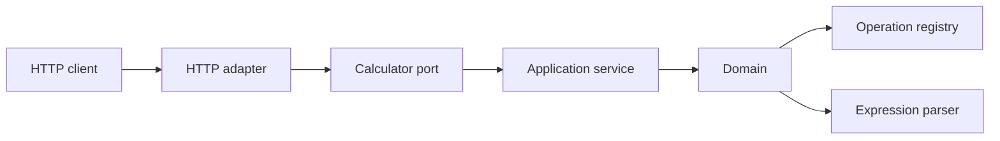

# Architecture

The service is a hexagon. Dependencies point inward: HTTP knows about the application port, the application knows about the domain, and the domain knows only about decimal arithmetic.

`cmd/api` is the composition root. It is the only place that chooses the HTTP adapter and the concrete service.

## Where code goes

| Change | Touch |
| --- | --- |
| New operation such as modulo | One entry in `internal/domain/arithmetic.go`. The list endpoint and `POST /calculate` pick it up. |
| New expression syntax | `internal/domain/expression.go`, reusing the same arithmetic functions |
| New transport | A new adapter that depends on `application/port.Calculator` |
| New environment variable | `internal/platform/config` |

The application service is thin on purpose. It is the place for a future history log or audit trail. Arithmetic rules do not belong there, and HTTP status codes do not belong in the domain.

## Request path

1. The router applies panic recovery, logging, CORS, and a five-second timeout.
2. The handler decodes JSON, rejects unknown fields, and parses operands from the raw JSON text.
3. The service calls `domain.Apply` or `domain.Evaluate`.
4. Domain errors carry a stable code. The handler maps that code to 400 or 422.

There is no database. The calculator is stateless, so there is no outbound port yet. When a history feature arrives, it should be an outbound port implemented by a new adapter, not a change to the parser.
